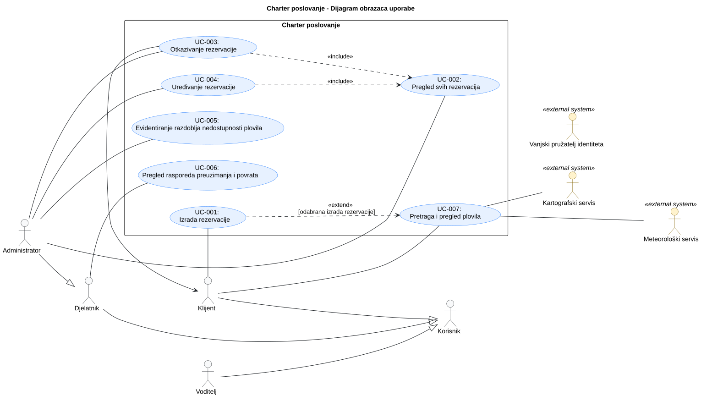
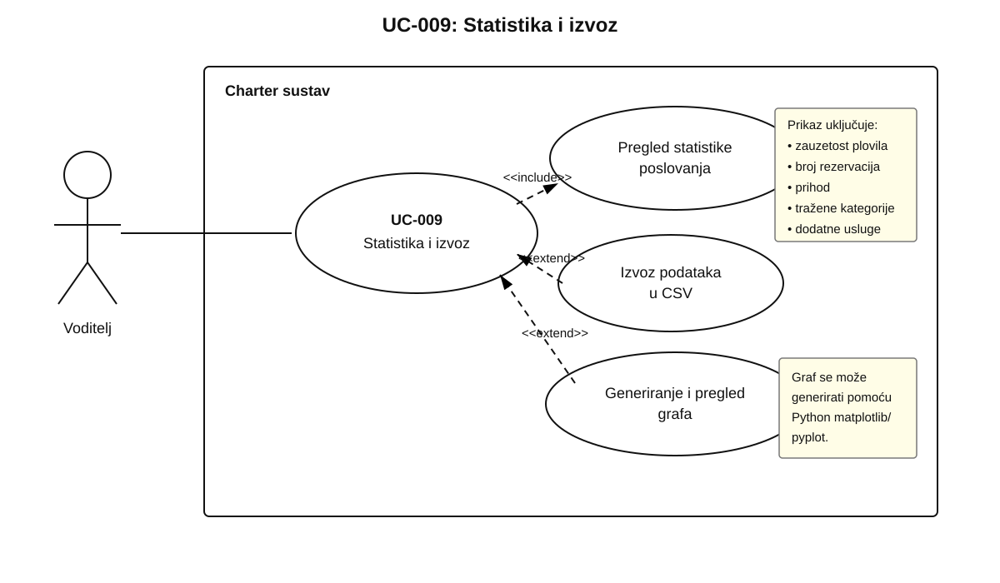

# 3. Obrasci uporabe

**Cilj:** Prikazati glavne interakcije između aktera aplikacije i sustava. Opišite kako akter ostvaruje cilj i što se događa kada važan korak ne uspije. Interakcije temeljite na odobrenim zahtjevima i ažurirajte ih kako se aplikacija razvija.

## 3.1 Dijagram obrazaca uporabe

**Cilj:** Prikazati granicu sustava, relevantne aktere i njihove glavne ciljeve u **preglednom UML dijagramu obrazaca uporabe**. Ako je za razumijevanje pojedinog dijela sustava potrebno prikazati više detalja, taj dio izdvojite u dodatni usmjereni dijagram. Dodatni dijagrami trebaju produbiti dio preglednog modela, a ne stvarati nepovezane ili duplicirane prikaze istog sustava.

**Slika 3.1.** Dijagram obrazaca uporabe

**PlantUML izvor:** [izvor](./puml/3-1-UC.puml)

**Provjera dijagrama:** Prikažite prepoznate uloge koje **komuniciraju s aplikacijom**, a ne dionike koji s njom nemaju interakciju. Svaki glavni korisnički cilj mora imati pridruženog aktera; uključeni obrazac uporabe može se dosegnuti preko drugog obrasca uporabe bez vlastite izravne veze s akterom. `<<include>>` i `<<extend>>` koristite samo kada odnos odgovara stvarnom ponašanju.

## 3.2 Specifikacije obrazaca uporabe

**Cilj:** Za svaki obrazac uporabe iz dijagrama objasniti cilj aktera, uobičajenu interakciju s aplikacijom i važne alternative. Jednostavne obrasce uporabe opišite kratko; proširite one kod kojih alternative, vanjske ovisnosti ili posljedice zahtijevaju dodatno objašnjenje.

**Za svaki obrazac uporabe koristite jednu okomitu tablicu.** Navedite samo onoliko pojedinosti koliko interakcija zahtijeva; neprimjenjivu alternativu izostavite umjesto da je popunjavate samo radi forme.

### UC-001: Izrada rezervacije

| Element specifikacije             | Opis                                                                                                                                                                                                                                                                                                                                                                                                                                                                                                                                                                                                                                                                                                                                                                                                                                                                                                                                                                                                                                             |
| :-------------------------------- | :----------------------------------------------------------------------------------------------------------------------------------------------------------------------------------------------------------------------------------------------------------------------------------------------------------------------------------------------------------------------------------------------------------------------------------------------------------------------------------------------------------------------------------------------------------------------------------------------------------------------------------------------------------------------------------------------------------------------------------------------------------------------------------------------------------------------------------------------------------------------------------------------------------------------------------------------------------------------------------------------------------------------------------------------- |
| **Primarni akter**                | Klijent                                                                                                                                                                                                                                                                                                                                                                                                                                                                                                                                                                                                                                                                                                                                                                                                                                                                                                                                                                                                                                          |
| **Povezani zahtjevi**             | F-3.1, F-3.2, F-4.2, NF-01 |
| **Preduvjeti**                    | Klijent je prijavljen. Korisnik ima ulogu klijenta.                                                                                                                                                                                                                                                                                                                                                                                                                                                                                                                                                                                                                                                                                                                                                                                                                                                                                                                                                                                              |
| **Glavni uspješni tok**           | 1. Klijent odabire plovilo i slobodan termin te upisuje broj osoba. 2. Odabire „Nastavi“, čime dobiva privremenu blokadu termina – u bazi podataka radi se privremena rezervacija sa statusom „u tijeku“. 3. Odabir dodatnih usluga. 4. Potvrda rezervacije odabirom „Rezerviraj“. 5. Privremena rezervacija mijenja status u „potvrđena“. 6. Klijent dobiva obavijest o potvrdi rezervacije e-poštom.                                                                                                                                                                                                                                                                                                                                                                                                                                                                                                                                                                                                                            |
| **Alternativni tokovi / Iznimke** | **2a — Broj osoba:** Klijent upisuje broj osoba veći od kapaciteta plovila, stoga odabirom „Nastavi“ dobiva obavijest u aplikaciji da broj osoba nadmašuje kapacitet plovila. Ne dobiva privremenu blokadu termina (privremenu rezervaciju) – termin se nastavlja prikazivati kao slobodan ostalim klijentima. Isti klijent ima mogućnost ispraviti broj osoba i pokušati ponovno kliknuti „Nastavi“. **2b — Termin u međuvremenu blokiran:** Drugi klijent je prije kliknuo „Nastavi“ za isto plovilo i isti termin. Klijentu se javlja da je termin zauzet (jer je započela privremena blokada za drugog klijenta) te ne dobiva privremenu blokadu. Klijent može i dalje odabrati drugi termin ili drugo plovilo. **4a — Potvrda rezervacije nakon isteka blokade:** Prošlo je više od 10 min od klika „Nastavi“ bez potvrde rezervacije. Sustav briše privremenu rezervaciju i oslobađa termin. Javlja klijentu da je privremena blokada istekla. Klijent mora ponovno započeti rezervaciju – termin može u međuvremenu postati zauzet. |
| **Posljedice (ishod)**            | • U bazi podataka postoji nova rezervacija sa statusom „potvrđena“. • Termin je zauzet za ostale klijente. • Klijent je dobio potvrdu e-poštom i može rezervaciju vidjeti među svojim rezervacijama.                                                                                                                                                                                                                                                                                                                                                                                                                                                                                                                                                                                                                                                                                                                                                                                                                                       |

### UC-002: Pregled svih rezervacija

| Element specifikacije             | Opis |
| :-------------------------------- | :--- |
| **Primarni akter**                | Administrator |
| **Povezani zahtjevi**             | F-6.1 |
| **Preduvjeti**                    | Korisnik mora biti prijavljen u sustav i dodijeljena mu je uloga administratora. |
| **Glavni uspješni tok**           | 1. Administrator otvara stranicu s popisom svih rezervacija. 2. Aplikacija dohvaća i prikazuje sve rezervacije osim onih označenih kao u tijeku. 3. Administrator odabire rezervaciju za koju želi vidjeti pojedinosti. 4. Aplikacija prikazuje pojedinosti o odabranoj rezervaciji i dostupne radnje za upravljanje istom. |
| **Alternativni tokovi / Iznimke** | **2a — Nema zabilježenih rezervacija:** Aplikacija prikazuje poruku kako trenutačno nema zabilježenih rezervacija. |
| **Posljedice (ishod)**            | Administrator može pregledati rezervacije i njihove pojedinosti. |

### UC-003: Otkazivanje rezervacije

| Element specifikacije             | Opis |
| :-------------------------------- | :--- |
| **Primarni akter**                | Administrator     |
| **Povezani zahtjevi**             | F-6.1 |
| **Preduvjeti**                    | Korisnik mora biti prijavljen u sustav, dodijeljena mu je uloga administratora i postoji rezervacija koju je moguće otkazati.     |
| **Glavni uspješni tok**           | 1. Administrator otvara stranicu s popisom svih rezervacija. 2. Aplikacija dohvaća i prikazuje sve rezervacije osim onih označenih kao u tijeku. 3. Administrator odabire rezervaciju koju želi otkazati. 4. Aplikacija prikazuje pojedinosti o odabranoj rezervaciji i dostupne radnje za upravljanje istom. 5. Administrator odabire radnju otkazivanja rezervacije. 6. Aplikacija traži potvrdu radnje otkazivanja. 7. Administrator potvrđuje otkazivanje. 8. Aplikacija provjerava ovlasti, mijenja status rezervacije, obavještava korisnika o novom statusu i prikazuje novi status.     |
| **Alternativni tokovi / Iznimke** | **4a — Odabranu rezervaciju nije moguće otkazati:** Odabrana rezervacija već je otkazana ili završena te za nju nije ponuđena radnja otkazivanja. **7a — Administrator nije potvrdio otkazivanje:** Rezervacija zadržava svoj početni status. **8a — Nedovoljne ovlasti:** Aplikacija ne otkazuje rezervaciju i prikazuje poruku o grešci.     |
| **Posljedice (ishod)**            | Aplikacija mijenja status rezervacije u otkazana i obavještava korisnika o otkazivanju njegove rezervacije.     |

### UC-004: Uređivanje rezervacije

| Element specifikacije             | Opis |
| :-------------------------------- | :--- |
| **Primarni akter**                | Administrator     |
| **Povezani zahtjevi**             | F-6.1, NF-01 |
| **Preduvjeti**                    | Korisnik mora biti prijavljen u sustav, dodijeljena mu je uloga administratora i postoji rezervacija koju je moguće urediti.     |
| **Glavni uspješni tok**           | 1. Administrator otvara stranicu s popisom svih rezervacija. 2. Aplikacija dohvaća i prikazuje sve rezervacije osim onih označenih kao u tijeku. 3. Administrator odabire rezervaciju koju želi urediti. 4. Aplikacija prikazuje pojedinosti o odabranoj rezervaciji i dostupne radnje za upravljanje istom. 5. Administrator odabire radnju uređivanja. 6. Aplikacija prikazuje formu s podatcima o rezervaciji. 7. Administrator mijenja podatke o rezervaciji (datum preuzimanja, završetka najma, broj osoba...) i potvrđuje izmjene. 8. Aplikacija provjerava ovlasti, jesu li podatci u skladu s pravilima izrade rezervacije, mijenja podatke o rezervaciji i prikazuje poruku o potvrdi izmjena.     |
| **Alternativni tokovi / Iznimke** | **4a — Rezervaciju nije moguće urediti:** Odabrana rezervacija već je otkazana ili završena te za nju nije ponuđena radnja uređivanja. **7a — Administrator nije potvrdio izmjene:** Podatci o rezervaciji ostaju nepromijenjeni. **8a — Nedovoljne ovlasti:** Aplikacija ne mijenja podatke o rezervaciji i prikazuje poruku o grešci. **8b — Plovilo iz rezervacije nije dostupno u odabranom razdoblju:** Aplikacija prikazuje poruku o nedostupnosti plovila. **8c — Uneseni podatci ne slijede pravila izrade rezervacije:** Aplikacija prikazuje poruku o grešci.     |
| **Posljedice (ishod)**            | Aplikacija mijenja podatke o rezervaciji i prikazuje poruku o potvrdi izmjena.     |

### UC-005: Evidentiranje razdoblja nedostupnosti plovila

| Element specifikacije             | Opis |
| :-------------------------------- | :--- |
| **Primarni akter**                |  Administrator    |
| **Povezani zahtjevi**             | F-7.1, F-2.1 |
| **Preduvjeti**                    |  Administrator je prijavljen i ima ovlast upravljanja flotom. Plovilo postoji u floti.    |
| **Glavni uspješni tok**           |  1. Administrator na stranici „Upravljanje flotom“ odabire plovilo i „Evidentiraj nedostupnost“. 2. Aplikacija prikazuje obrazac (datum od, datum do, razlog). 3. Administrator unosi podatke i potvrđuje. 4. Aplikacija na poslužitelju provjerava ovlasti i valjanost datuma (početak prije kraja, ne u prošlosti). 5. Aplikacija provjerava zauzetost plovila u razdoblju (potvrđene rezervacije, blokade u tijeku, druga razdoblja nedostupnosti). 6. Aplikacija trajno sprema razdoblje i prikazuje potvrdu. |
| **Alternativni tokovi / Iznimke** | **4a — Nedovoljne ovlasti:** aplikacija odbija zahtjev i ništa ne sprema. **4b — Nevaljani datumi:** aplikacija objašnjava problem i zadržava unos; administrator ispravlja i ponavlja korak 3. **5a — Preklapanje s potvrđenom rezervacijom:** aplikacija odbija unos i prikazuje koja rezervacija smeta; administrator odustaje ili prvo otkaže rezervaciju (UC-003) pa ponavlja unos. **5b — Preklapanje s blokadom u tijeku ili drugim razdobljem:** aplikacija odbija unos i navodi razlog; administrator mijenja razdoblje ili pokušava kasnije. **6a — Spremanje nije uspjelo:** aplikacija javlja pogrešku i ne prikazuje lažnu potvrdu. |
| **Posljedice (ishod)** | Razdoblje nedostupnosti je pohranjeno. U tom razdoblju plovilo se ne prikazuje kao slobodno i ne može se rezervirati. |

### UC-006: Pregled rasporeda preuzimanja i povrata

| Element specifikacije             | Opis |
| :-------------------------------- | :--- |
| **Primarni akter**                | Djelatnik     |
| **Povezani zahtjevi**             | F-5.1 |
| **Preduvjeti**                    | Korisnik mora biti prijavljen u sustav i dodijeljena mu je uloga djelatnika ili administratora.     |
| **Glavni uspješni tok**           | 1. Djelatnik otvara stranicu namijenjenu za pregled rasporeda preuzimanja i povrata plovila.  2. Aplikacija dohvaća sve potvrđene rezervacije i prikazuje njihov raspored. 3. Djelatnik odabire pojedinu rezervaciju koju želi detaljnije pregledati. 4. Aplikacija prikazuje jedinstveni identifikator, plovilo, matičnu luku, datum i vrijeme preuzimanja i povrata, odabrane dodatne usluge, cijenu i broj osoba, te osnovne podatke o klijentu (ime i prezime, broj telefona, adresa e-pošte).|
| **Alternativni tokovi / Iznimke** | **2a - Nema potvrđenih rezervacija:** Aplikacija prikazuje poruku da trenutačno nema što prikazati.   |
| **Posljedice (ishod)**            | Djelatnik pregledava raspored preuzimanja i povrata s odgovarajućim podacima svakog najma, te pri tome podaci u sustavu ostaju nepromijenjeni.     |

### UC-007: Pretraga i pregled plovila

| Element specifikacije             | Opis |
| :-------------------------------- | :--- |
| **Primarni akter**                | Korisnik     |
| **Povezani zahtjevi**             | F-2.1, F-2.2, F-10.1, F-10.2, NF-02 |
| **Preduvjeti**                    | Klijent mora biti prijavljen u sustav.     |
| **Glavni uspješni tok**           | 1. Korisnik otvara stranicu za pretragu. Aplikacija prikazuje popis plovila s osnovnim podacima. 2. Korisnik unosi željene kriterije: termin, broj osoba, lokaciju polaska, vrstu plovila, cijenu, broj kabina, opremu i dodatne usluge. 3. Aplikacija prikazuje plovila koja odgovaraju kriterijima. Ako je unesen termin, prikazuju se samo plovila slobodna u cijelom razdoblju i ukupna cijena najma. 4. Korisnik odabire plovilo. 5. Aplikacija prikazuje sve podatke o plovilu, fotografije, cijenu, dodatne usluge s cijenama i slobodne termine. Prikazuje i matičnu luku na karti te vremensku prognozu za odabrani termin.     |
| **Alternativni tokovi / Iznimke** | **3a — Neispravan termin ili nema rezultata:** aplikacija prikazuje poruku i korisnik mijenja kriterije. **5a — Vanjski servis nije dostupan:** karta ili prognoza se ne prikazuju, a ostatak stranice radi normalno.     |
| **Posljedice (ishod)**            | Korisnik je pregledao plovila koja odgovaraju kriterijima. Stanje sustava se ne mijenja.     |

### UC-008: Upravljanje plovilima i dodatnim uslugama

| Element specifikacije             | Opis |
| :-------------------------------- | :--- |
| **Primarni akter**                | Administrator |
| **Povezani zahtjevi**             | F-7.1 |
| **Preduvjeti**                    | Korisnik mora biti prijavljen u sustav i dodijeljena mu je uloga administratora. |
| **Glavni uspješni tok**           | 1. Administrator otvara stranicu za upravljanje flotom; aplikacija prikazuje popis plovila. 2. Administrator odabire plovilo koje želi urediti; aplikacija prikazuje obrazac s njegovim podacima. 3. Administrator mijenja podatke o plovilu, opremi, cijeni najma i dodatnim uslugama te potvrđuje promjene. 4. Aplikacija provjerava ovlasti i valjanost podataka, sprema promjene i prikazuje potvrdu. |
| **Alternativni tokovi / Iznimke** | **2a — Dodavanje novog plovila:** Administrator odabire „Dodaj plovilo”; aplikacija prikazuje prazan obrazac i tok se nastavlja od koraka 3. **4b — Nedovoljne ovlasti:** Aplikacija odbija zahtjev i ne sprema promjene. **4c — Spremanje nije uspjelo:** Aplikacija prikazuje poruku o pogrešci| 
| **Posljedice (ishod)**            | Podaci o plovilu, njegovoj opremi,### UC-009: Statistika i izvoz

**Slika 3.9.** Dijagram obrasca uporabe „Statistika i izvoz“

| Element specifikacije             | Opis |
| :-------------------------------- | :--- |
| **Primarni akter**                | Voditelj |
| **Povezani zahtjevi**             | F-9.1, F-9.2 |
| **Preduvjeti**                    | Korisnik mora biti prijavljen u sustav i dodijeljena mu je uloga voditelja. |
| **Glavni uspješni tok**           | 1. Voditelj otvara stranicu za statistiku poslovanja. 2. Aplikacija prikazuje dostupne statističke pokazatelje. 3. Voditelj odabire razdoblje ili druge dostupne kriterije pregleda. 4. Aplikacija dohvaća i obrađuje podatke o rezervacijama, plovilima, prihodima i dodatnim uslugama. 5. Aplikacija prikazuje zauzetost pojedinih plovila, broj rezervacija, ostvareni prihod, najtraženije kategorije plovila i najtraženije dodatne usluge. 6. Voditelj po potrebi odabire podatke koje želi izvesti. 7. Voditelj odabire dostupni standardni format izvoza. 8. Aplikacija generira datoteku s odabranim podacima i omogućuje njezin izvoz. |
| **Alternativni tokovi / Iznimke** | **4a — Nema podataka za odabrano razdoblje:** Aplikacija prikazuje poruku da za odabrane kriterije nema podataka. **4b — Pogreška pri dohvaćanju podataka:** Aplikacija prikazuje poruku o pogrešci i statistika se ne prikazuje dok podaci nisu uspješno dohvaćeni. **7a — Nije odabran format izvoza:** Aplikacija traži od voditelja da odabere jedan od podržanih formata prije izvoza. **8a — Izvoz nije uspio:** Aplikacija prikazuje poruku o pogrešci i ne prikazuje lažnu potvrdu uspješnog izvoza. **8b — Nedovoljne ovlasti:** Aplikacija odbija pristup funkcionalnosti statistike i izvoza. |
| **Posljedice (ishod)**            | Voditelj je pregledao statističke podatke poslovanja. Ako je odabran izvoz, generirana je datoteka s odabranim podacima u podržanom standardnom formatu. |

### UC-010: Prijava korisnika

| Element specifikacije             | Opis |
| :-------------------------------- | :--- |
| **Primarni akter**                | Neprijavljeni korisnik |
| **Povezani zahtjevi**             | F-1.1, NF-03 |
| **Preduvjeti**                    | Korisnik nije prijavljen u sustav. Vanjski pružatelj identiteta dostupan je za provođenje prijave. |
| **Glavni uspješni tok**           | 1. Neprijavljeni korisnik odabire prijavu u aplikaciju. 2. Aplikacija preusmjerava korisnika vanjskom pružatelju identiteta. 3. Korisnik se prijavljuje kod vanjskog pružatelja identiteta. 4. Nakon uspješne prijave vanjski pružatelj identiteta vraća korisnika u aplikaciju s podacima potrebnima za potvrdu identiteta. 5. Aplikacija provjerava valjanost prijave i utvrđuje postoji li korisnički račun. 6. Ako se korisnik prijavljuje prvi put, aplikacija izrađuje korisnički račun i automatski mu dodjeljuje ulogu klijenta. 7. Aplikacija prijavljuje korisnika i omogućuje mu funkcionalnosti dostupne njegovoj ulozi. |
| **Alternativni tokovi / Iznimke** | **3a — Neuspješna prijava kod vanjskog pružatelja identiteta:** Korisnik nije uspješno potvrdio identitet ili je odustao od prijave. Aplikacija ga ne prijavljuje i vraća ga u neprijavljeno stanje. **4a — Vanjski pružatelj identiteta nije dostupan:** Prijava se ne može dovršiti. Aplikacija korisniku prikazuje poruku da prijava trenutačno nije dostupna. **5a — Podaci prijave nisu valjani:** Aplikacija odbija prijavu i ne otvara korisničku sesiju. **6a — Izrada korisničkog računa nije uspjela:** Aplikacija ne prijavljuje novog korisnika i prikazuje poruku o pogrešci. |
| **Posljedice (ishod)**            | Korisnik je uspješno prijavljen. Ako se prijavio prvi put, u sustavu postoji novi korisnički račun s ulogom klijenta. Aplikacija prikazuje funkcionalnosti dopuštene njegovoj ulozi. |

---

## 3.3 Provjera dosljednosti obrazaca uporabe

**Cilj:** Provjeriti međusobnu usklađenost obrazaca uporabe, aktera, zahtjeva i ispitnih slučajeva. Cjelovito mapiranje održava se isključivo u **[matrici sljedivosti zahtjeva](2-Analiza-zahtjeva.md#26-sljedivost-zahtjeva)**.

| Provjera   | Pitanje za tim                                                                                                              | Zaključak |
| ---------- | --------------------------------------------------------------------------------------------------------------------------- | --------- |
| Zahtjev    | Je li svaki važan obrazac uporabe povezan s postojećim zahtjevom?                                                           |Da           |
| Akter      | Odgovara li akter naveden ovdje prethodno utvrđenoj ulozi i dopuštenoj interakciji?                                         |Da           |
| Aplikacija | Može li tim demonstrirati opisani glavni rezultat i važnu alternativu ili je opis jasno označen kao trenutačno oblikovanje? |           |

---

Povezivanje zahtjev → obrazac uporabe → ispitivanje održavajte **samo jednom, u [tablici sljedivosti zahtjeva](./2-Analiza-zahtjeva.md)**. Ovdje nemojte održavati drugu projektnu tablicu mapiranja ni stupac sa statusom implementacije. Ako važan zahtjev nema interakciju s ljudskim akterom, objasnite gdje se obrađuje umjesto izmišljanja aktera.

**Završna provjera:** Dijagram, specifikacije obrazaca uporabe i matrica sljedivosti međusobno su usklađeni. Svaki važan obrazac uporabe povezan je s postojećim zahtjevom, akteri odgovaraju stvarnim ulogama u aplikaciji, a opisani glavni i alternativni tokovi odgovaraju ponašanju koje sustav stvarno podržava.
