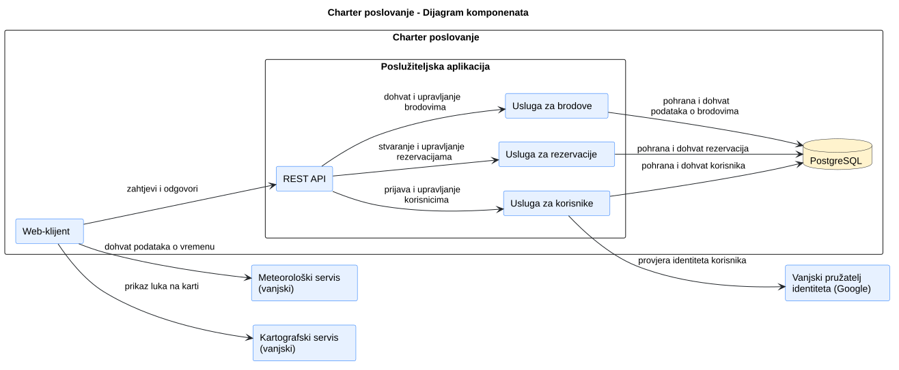
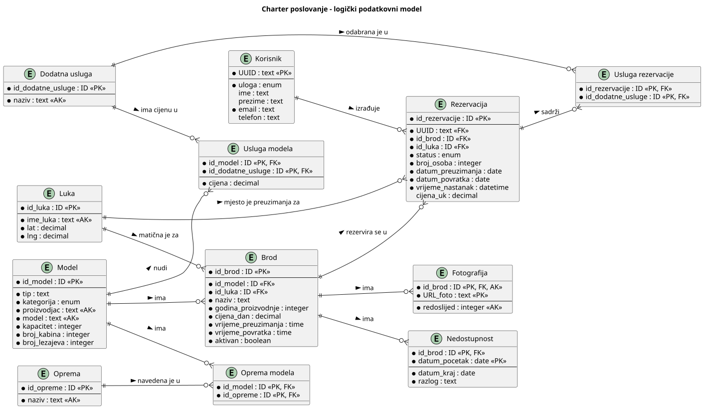
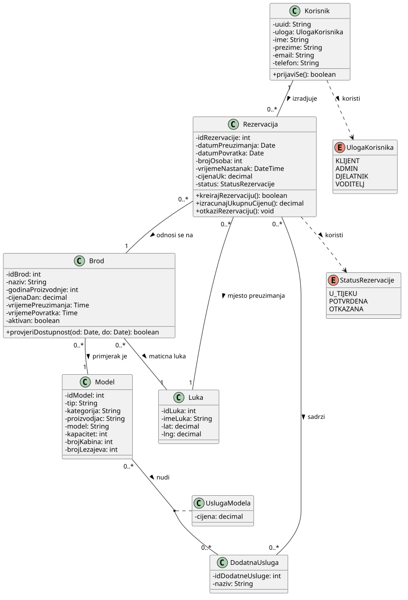
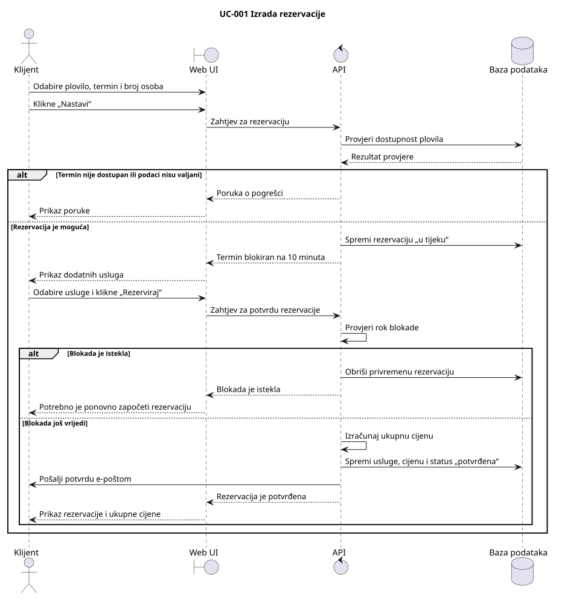
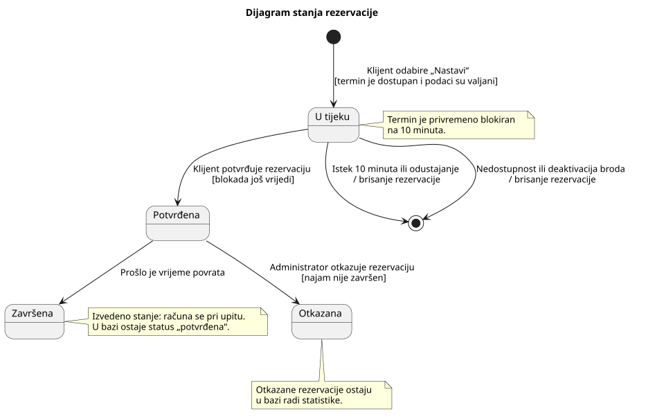

# 4. Arhitektura i oblikovanje

**Cilj:** Definirati arhitekturni stil, dekompoziciju programa na podsustave i module, organizaciju podataka te dinamičko ponašanje tijekom izvođenja. Arhitektura predstavlja temelj za implementaciju i ažurira se pri svakoj važnijoj promjeni projektnih odluka.

| Arhitekturni pogled | Ključno inženjersko pitanje | Primijenjeni model ili dijagram |
| :--- | :--- | :--- |
| **Strategija rješenja** | Koji stil i temeljne odluke određuju program? | Tablica odluka (odjeljak 4.1) |
| **Struktura podsustava** | Koji su glavni dijelovi i kako komuniciraju? | Dijagram komponenata |
| **Model podataka** | Kako su strukturirani trajni podaci programa? | Relacijski ER dijagram |
| **Struktura koda** | Kako su dodijeljene odgovornosti i ključne klase? | Reprezentativni dijagram razreda |
| **Dinamičko ponašanje** | Kako moduli surađuju pri obradi ključnih transakcija? | sekvencijski dijagram |
| **Stanja sustava** | Kako ključni domenski objekt mijenja svoja stanja? | Dijagram stanja |
| **Fizički razmještaj** | Na kojim se izvršnim čvorovima program izvodi? | Dijagram razmještaja (poglavlje 6) |

---

## 4.1 Ključne arhitekturne odluke

**Cilj:** Objasniti nekoliko arhitekturnih odluka koje najviše utječu na rješenje i navesti njihove projektno specifične razloge.

| Odluka | Razmatrana alternativa | Projektno specifično obrazloženje i kompromis |
| --- | --- | --- |
| Čim klijent klikne "Nastavi" sustav privremeno blokira termin na 10 minuta. | Termin dobiva klijent koji prvi popuni i potvrdi rezervaciju. | Nakon pritiska "Nastavi" klijent odabire dodatne usluge i potvrđuje rezervaciju. Bez blokade drugi klijent bi ga mogao preduhitriti i oduzeti mu termin nakon što prvi već ispuni podatke. Ovako se jamči da se rezervacija može ispuniti bez rizika gubitka (F-4.5, F-4.6, F-4.8). |
| Djelatnik, voditelj ili administrator se mora prijaviti novim klijentskim računom ako želi rezervirati plovilo. | Svaka uloga može vršiti rezervacije | Samo klijent može rezervirati plovilo (F-4.3), a svaki korisnik ima jednu ulogu. Sustav time ne miješa službene ovlasti i potencijalne klijentske zahtjeve te nije potrebno implementirati kombinirano sučelje. Kompromisno rješenje je da određene osobe moraju izraditi dva računa. |

## 4.2 Gradivni blokovi i UML dijagram komponenata

**Cilj:** Prikazati logičku podjelu programa na komponente, njihova sučelja i vanjske integracije. Dijagram komponenata prikazuje logičku organizaciju, dok dijagram razmještaja prikazuje fizičko izvođenje. Ovaj prikaz ažurirajte kako sustav poprima konačan oblik.

**Dijagram komponenata:**   
**PlantUML izvor:** [izvor](./puml/4-2-dijagram-komponenata.puml)

| Komponenta | Odgovornost | Razlog za ovu granicu |
| --- | --- | --- |
| Web-klijent | Prikazuje plovila i omogućuje rezervaciju istih. Omogućava prijavu u sustav, pregled i upravljanje rezervacijama, flotom i korisnicima, izvoz podataka te prikaz statistike.  | Korisnička interakcija odvojena je od pravila pohrane i pristupa bazi podataka. |
| REST API | Prihvaća zahtjeve web-klijenta, prosljeđuje ih ostalim komponentama sustava te vraća odgovore.  | Odgovornosti izložene putem HTTP-a odvojene su od procesa obrade podataka. |
| Usluga za brodove | Dohvaćanje i upravljanje podatcima o modelima, brodovima, njihovim osnovnim i dodatnim uslugama te razdobljima nedostupnosti.  | Funkcionalnosti vezane za dohvat i upravljanje plovilima odvojene su od ostalih funkcionalnosti sustava. |
| Usluga za rezervacije | Dohvaća rezervacije i omogućuje stvaranje, izmjenu i otkazivanje rezervacija. | Funkcionalnosti vezane uz dohvat i upravljanje rezervacijama odvojene su od ostalih funkcionalnosti sustava. |
| Usluga za korisnike | Upravljanje korisnicima i prijava putem vanjskog pružatelja identiteta. | Funkcionalnosti vezane uz prijavu i upravljanje korisnicima odvojene su od ostalih funkcionalnosti sustava. |
| Meteorološki servis (vanjski) | Dohvat i prikaz podataka o vremenu za odabrano razdoblje | Nemogućnost prikupljanja vlastitih meteoroloških podataka. |
| Kartografski servis (vanjski) | Prikaz luka na karti. | Nemogućnost izrade vlastitog sustava. |
| Vanjski pružatelj identiteta (Google) | Prijava korisnika putem njihovih Google računa. | Očekuje se implementacija prijave korisnika putem jednog od vanjskih pružatelja identiteta. |
| PostgreSQL | Pohrana svih relevantnih podataka. | Pohrana podataka odvojena je od provjere njihove valjanosti i prikaza korisniku. |

## 4.3 Model podataka i oblikovanje razreda

**Cilj:** Objasniti važne informacije koje aplikacija pohranjuje i jedno reprezentativno područje oblikovanja na razini razreda. Model podataka i UML dijagram razreda odgovaraju na različita pitanja; jedno ne zamjenjuje drugo.

### 4.3.1 ER dijagram i model podataka

**Cilj:** Prikazati važne pohranjene entitete, njihove identifikatore i veze te dovoljno atributa za razumijevanje podataka aplikacije. ER dijagram odvojen je od reprezentativnog UML dijagrama razreda u nastavku.

**Slika 4.2. ER dijagram podataka sustava Charter poslovanje**

**Izvor dijagrama:** [izvor](./puml/4-2-charter-data-ERD.puml)  
**Implementacija:** [db/migrations/001_initial_schema.sql](../db/migrations/001_initial_schema.sql)

### 4.3.2 Reprezentativni UML dijagram razreda

**Cilj:** Prije implementacije reprezentativnog dijela sustava modelirati i prikazati razrede ili sučelja potrebna za dodjelu odgovornosti, operacija i veza. Oblikovanje ažurirajte kada se te odluke promijene.

**Slika 4.3. UML dijagram razreda sustava Charter poslovanje**

**PlantUML izvor:** [izvor](./puml/4.3.2-UMLrazreda.puml)  
**Referenca na kod pri završnom pregledu:** [Poveznica na odgovarajuću implementaciju.]

## 4.4 Ponašanje tijekom izvođenja

**Cilj:** Objasniti jednu važnu interakciju među dijelovima koji se izvode i životni ciklus jednog smislenog objekta.

### 4.4.1 Reprezentativni UML sekvencijski dijagram

**Cilj:** Prikazati redoslijed poruka za jedan reprezentativni scenarij i odgovore na važnu alternativu.

**Scenarij:** UC-001: Izrada rezervacije

Klijent odabire plovilo, termin i broj osoba. Sustav provjerava
dostupnost te izrađuje rezervaciju „u tijeku“, koja blokira termin
na 10 minuta. Nakon odabira dodatnih usluga klijent potvrđuje
rezervaciju, a sustav sprema ukupnu cijenu i status „potvrđena“
te šalje potvrdu e-poštom.

Dijagram prikazuje i slučajeve kada rezervacija nije moguća
zbog zauzetog termina ili nevaljanih podataka te kada blokada
istekne prije potvrde rezervacije.

**Sekvencijski dijagram:**

**Slika 4.4.** Sekvencijski dijagram izrade rezervacije

**PlantUML izvor:** [Izrada rezervacije](./puml/4-4-1-izrada-rezervacije.puml)

### 4.4.2 Reprezentativni UML dijagram stanja

**Cilj:** Prikazati važna stanja jednog domenskog objekta ili
eksplicitno upravljanog načina rada sustava te događaje ili uvjete
koji ih mijenjaju.

**Vlasnik stanja i razlog odabira:** Rezervacija. Njezino stanje
određuju status, vrijeme nastanka i vrijeme povrata plovila.
Odabrana je jer prijelazi između stanja određuju zauzetost
termina i mogućnost potvrde ili otkazivanja rezervacije.

Rezervacija nastaje u stanju „u tijeku“ i blokira termin na
10 minuta. Pravodobnom potvrdom prelazi u stanje „potvrđena“.
Istekom blokade, odustajanjem klijenta ili gubitkom dostupnosti
broda privremena rezervacija briše se.

Administrator može otkazati potvrđenu rezervaciju koja još nije
završena. Nakon vremena povrata rezervacija se prikazuje kao
„završena“. To se stanje računa pri upitu, dok u bazi ostaje
status „potvrđena“. Otkazane i završene rezervacije čuvaju se
radi statistike.

**Dijagram stanja:**

**Slika 4.5.** Dijagram stanja rezervacije

**PlantUML izvor:** [Stanja rezervacije](./puml/4-4-2-stanja-rezervacije.puml)

## 4.5 Zapisi arhitekturnih odluka

**Cilj:** Sačuvati razloge i obrazložiti odabrane važne arhitekturne odluke kada tablica u odjelku 4.1 nije dovoljna za očuvanje konteksta, razmatranih alternativa i prihvaćenih kompromisa.

### ADR-[ID]: [Naslov odluke]

| Polje | Zapis odluke |
| --- | --- |
| Kontekst i cilj | [Koji je arhitekturni problem učinio ovu odluku potrebnom?] |
| Kriteriji odluke | [Što je timu stvarno bilo važno?] |
| Razmatrane alternative | [Realne mogućnosti koje je tim razmotrio, ukratko.] |
| Odluka i obrazloženje | [Odabrana mogućnost, zašto je odabrana i čega se tim odrekao.] |
| Status | [Predloženo, prihvaćeno ili zamijenjeno; ako je primjenjivo, poveznica na novu odluku.] |

## 4.6 Zajednička pravila oblikovanja (engl. Cross-cutting concerns)

**Cilj:** Prepoznati i opisati globalna pravila i mehanizme oblikovanja koji se primjenjuju u više dijelova aplikacije, navesti gdje se planira primijeniti i ažurirati objašnjenje kako implementacija poprima konačan oblik.

**Implementirani mehanizmi:**

| Aspekt | Mehanizam | Pravilo | Mjesto primjene |
| --- | --- | --- | --- |
|  |  |  |  |

## 4.7 Arhitekturni rizici i tehnički dug

**Cilj:** Navesti stvarne tehničke ili domenske rizike i svjesno prihvaćene kompromise oblikovanja, njihove posljedice i način na koji ih tim obrađuje.

**Tehnički rizici i dug**

| Rizik ili kompromis | Posljedica | Odgovor na rizik |
| --- | --- | --- |
|  |  |  |

**Poslovni ili domenski rizici, ako su značajni**

| Rizik | Posljedica | Odgovor na rizik |
| --- | --- | --- |
|  |  |  |

---

>**Završna provjera:** Usporedite dijagrame komponenata, podataka, razreda, sekvencijski dijagram i dijagram stanja s implementiranim kodom, ponašanjem aplikacije i stvarnim razmještajem. Ažurirajte zastarjele opise oblikovanja i objasnite svaku važnu razliku koja ostaje; poveznice na odgovarajući kod ili ispitivanja korisne su kada odgovaraju na konkretno pitanje.
